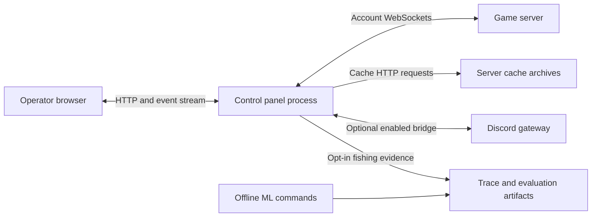

# Architecture overview

Source-checked 2026-09-24. The normal fleet is one Go process launched by [cmd/controlpanel](../cmd/controlpanel/main.go). It contains account sessions, bot runners, coordination and the HTTP panel server. The browser is an optional viewer/controller; it is not required for each account's game connection.

## Process boundaries

This is the current process shape, not the proposed controller/worker deployment from older design templates.

## Ownership inside the fleet process

| Layer | Owns | Source |
|---|---|---|
| Client session | Transport, login, packet framing/ciphers, read loop, keepalive and connection lifetime | [client](../internal/client/session.go), [transport](../internal/transport) |
| Game state | Decoded server position, skills, inventories, NPCs and interfaces | [gamestate](../internal/gamestate) |
| Named actions | Packet construction for walking, banking, interaction and trade | [actions](../internal/actions) |
| Script runtime | Registry; OnStart/Loop/OnStop lifecycle; cancellable waits and reporting | [bot](../internal/bot/bot.go), [runner](../internal/bot/runner.go) |
| Script decisions and execution | Pure plan decisions, runner actions, registered adapter state | [porting framework](script_porting_framework.md), [scripts](../internal/scripts) |
| Navigation | Collision search, static locations, dynamic doors and transports | [pathfind](../internal/pathfind), [locindex](../internal/locindex), [webwalk](../internal/webwalk) |
| Random events | Detection, ownership and coordinated handling that ordinary scripts yield to | [randomevents](../internal/randomevents) |
| Fleet management | Accounts, routes, login pacing/retries, script start/stop and snapshots | [fleet](../internal/fleet) |
| Shared coordination | Mule message board, bank publications and trade records | [mulebus](../internal/mulebus), [peerbank](../internal/peerbank), [muleledger](../internal/muleledger) |
| Panel | Source abstraction, HTTP API, telemetry and embedded web assets | [controlpanel](../internal/controlpanel/server.go) |

The bot runner repeatedly calls Loop; it does not automatically call each bot once per server tick. Scripts implement pacing through their context and runner helpers. Packet decoding and bot work proceed concurrently. A snapshot is an observation, not an action completion acknowledgement.

## Configuration and persistence

The executable loads the roster and shared data, then supplies per-account settings through bot.Context. The [fleet configuration reference](fleet_config_reference.md) explains loader differences and precedence; the [script reference](bot_script_settings.md) explains settings.

Collision packs, static locations and cache definitions are shared inputs. Session state belongs to each account. Bank snapshots, statistics, assignments and layouts have separate persistence options; script checkpoints are separate from login state. Relative paths resolve from the working directory. Passwords, tokens, private rosters and raw logs are not repository examples.

## Optional and experimental systems

The [stream client](stream_client_panel.md) renders an existing session through an installed provider. Rendering and input depend on capabilities and launch flags; a view does not require a second game login.

[CrowdPlay](crowdplay/README.md) has a Discord bridge in internal/crowdplay, wired by cmd/controlpanel/crowdplay.go and disabled unless configured. The older internal/twitchplays controller is not the exact live execution path. A fake-gateway result is distinct from a real Discord deployment.

ML packages provide offline training/evaluation. ProgressiveFisher can emit opt-in decision traces, but this does not let an LLM change live policy. [Luna's task status](luna_task_status_2026-09-24.md) records implemented pieces and remaining gaps.

[Session IPC and hot reload](../HOTRELOAD.md) are experimental tools. The normal cmd/controlpanel/internal/fleet path does not import internal/sessionipc; replacing the panel executable still requires the controlled fleet restart procedure.

See [subsystem diagrams](subsystem_diagrams.md) and the [developer handbook](developer_handbook.md).
