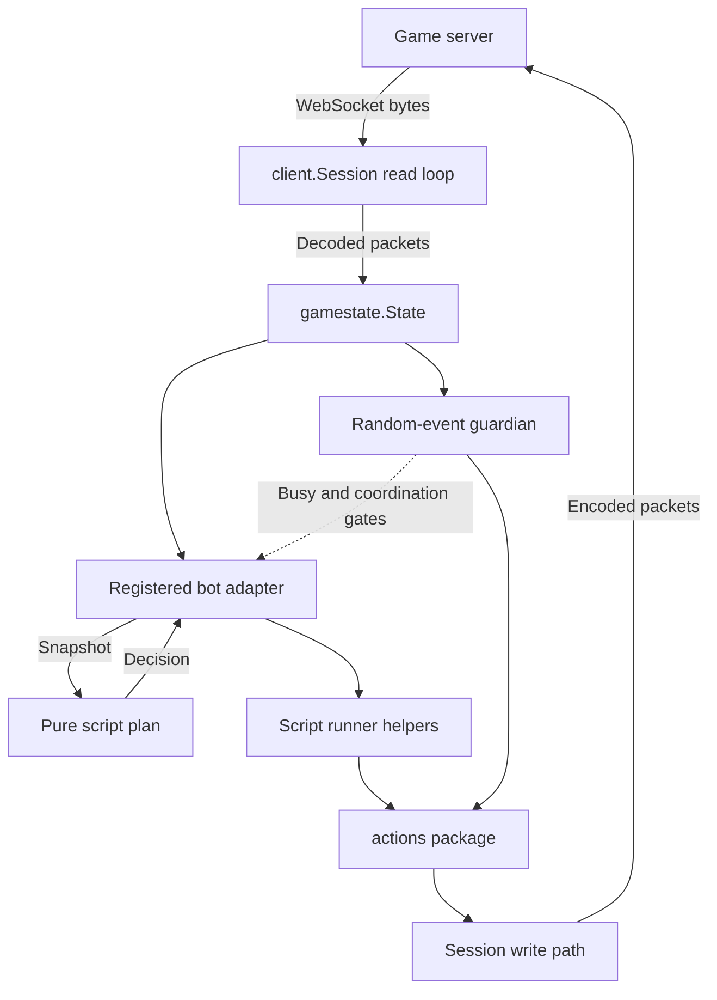
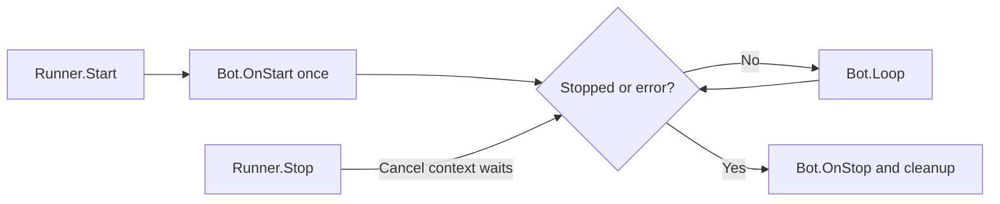
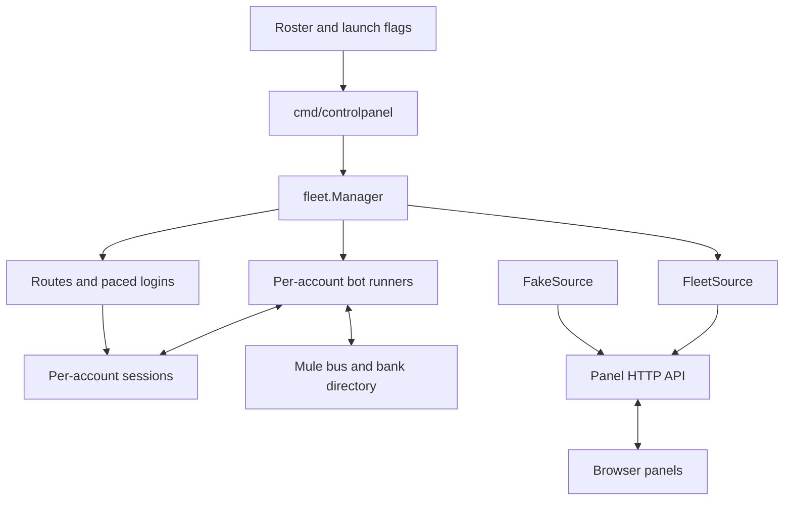
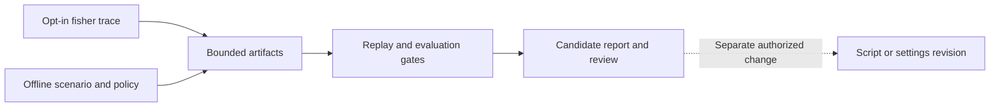

# Subsystem diagrams

Source-checked 2026-09-24. These describe the ordinary control-panel fleet; see [architecture](architecture_overview.md) for process boundaries.

## Account packet and action path

Sources: [session](../internal/client/session.go), [bot](../internal/bot/bot.go), [fisher](../internal/bot/fisher.go), [guardian](../internal/randomevents). Sending an action is not proof of server acceptance: runners wait for state changes and apply timeouts.

## Runner lifecycle and pacing

[Runner](../internal/bot/runner.go) runs each bot in a goroutine. Stop requests cancellation; Wait waits for shutdown. Scripts own delays and tick waits, so there is no automatic one-Loop-per-tick contract. A non-cancellable blocking call can delay shutdown. Bot panics are reported by the runner; this is not isolation from every process failure.

## Fleet and panel

Sources: [main](../cmd/controlpanel/main.go), [fleet](../internal/fleet), [FleetSource](../internal/controlpanel/fleetsource.go), [FakeSource](../internal/controlpanel/fake.go). FakeSource is an alternative, not another live roster. The browser does not own game sockets.

## Evidence boundary

Sources: [fisher](../internal/bot/fisher.go), [evaluation](../internal/ml/evaluation), [promotion](../internal/ml/promotion). The dotted revision step is an engineering workflow, not a deployed autonomous updater.
